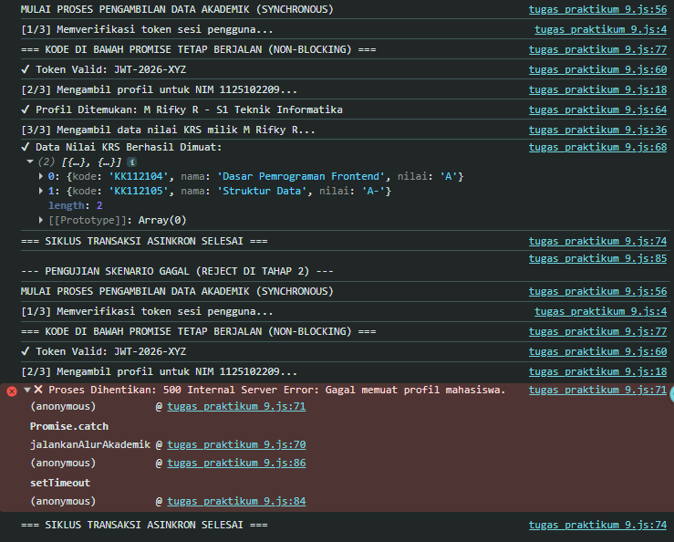

# Praktikum 9 — Pemrograman Asinkron (Asynchronous JavaScript) & Promise

**Identitas Mahasiswa:**
* **Nama:** M Rifky R
* **NIM:** 1125102209
* **Program Studi:** S1 Teknik Informatika — STIKOM PGRI Banyuwangi
* **Mata Kuliah:** Dasar Pemrograman Frontend (KK112104)

---

## 1. Bukti Tangkapan Layar Konsol (Console Log)

---

## 2. Analisis Arsitektur Event Loop & Eksekusi Non-Blocking

Berdasarkan urutan log yang muncul pada tab Console peramban, berikut adalah analisis mekanisme eksekusi kode:

1. **Bukti Perilaku Non-Blocking:**
   * Saat fungsi `jalankanAlurAkademik()` dipanggil, pesan `=== MULAI PROSES PENGAMBILAN DATA AKADEMIK (SYNCHRONOUS) ===` dan `[1/3] Memverifikasi token sesi pengguna...` langsung dicetak ke konsol karena fungsi *executor* di dalam konstruktor `new Promise()` dieksekusi secara *synchronous* di **Call Stack**.
   * Operasi `setTimeout()` di dalam `verifikasiToken()` kemudian didelegasikan ke **Web APIs** browser agar berjalan di latar belakang selama 1.000 ms tanpa menahan utas utama (*main thread*).
   * Akibatnya, baris log `=== KODE DI BAWAH PROMISE TETAP BERJALAN (NON-BLOCKING) ===` langsung tercetak **sebelum** satupun hasil `.then()` muncul. Ini membuktikan eksekusi kode di bawah rantai Promise tidak diblokir (*non-blocking*).

2. **Peran Call Stack, Web APIs, Microtask Queue, dan Event Loop:**
   * **Call Stack:** Mengeksekusi seluruh perintah *synchronous* dari atas ke bawah hingga kosong.
   * **Web APIs & Macrotask Queue:** Setelah timer `setTimeout()` selesai di Web APIs, callback-nya masuk ke Macrotask Queue untuk memanggil `resolve()` atau `reject()`.
   * **Microtask Queue:** Ketika status Promise berubah menjadi *Fulfilled* (`resolve`) atau *Rejected* (`reject`), handler `.then()`, `.catch()`, dan `.finally()` dimasukkan ke **Microtask Queue** yang memiliki prioritas lebih tinggi daripada Macrotask Queue.
   * **Event Loop:** Terus memantau **Call Stack**; begitu Call Stack kosong, Event Loop segera mengambil tugas dari **Microtask Queue** secara berurutan sehingga ketiga tahapan (*Verifikasi Token* $\rightarrow$ *Ambil Profil* $\rightarrow$ *Ambil Nilai KRS*) berjalan linear tanpa *Callback Hell*.

3. **Evaluasi Penanganan Galat (Error Handling):**
   * **Skenario 1 (Fulfilled):** Ketiga tahap berjalan berurutan menggunakan `return` pada setiap `.then()` dan ditutup oleh `.finally()`.
   * **Skenario 2 (Rejected di Tahap 2):** Saat `ambilProfilMahasiswa` memanggil `reject()`, rantai `.then()` berikutnya (`ambilNilaiKRS`) otomatis dilewati dan alur langsung melompat ke blok `.catch()` untuk menampilkan pesan error `500 Internal Server Error`, lalu tetap diakhiri oleh blok `.finally()`.